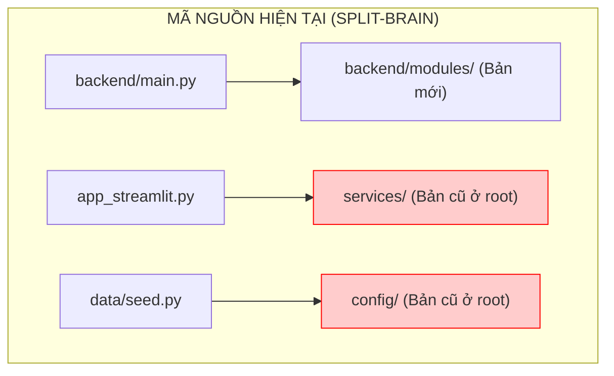
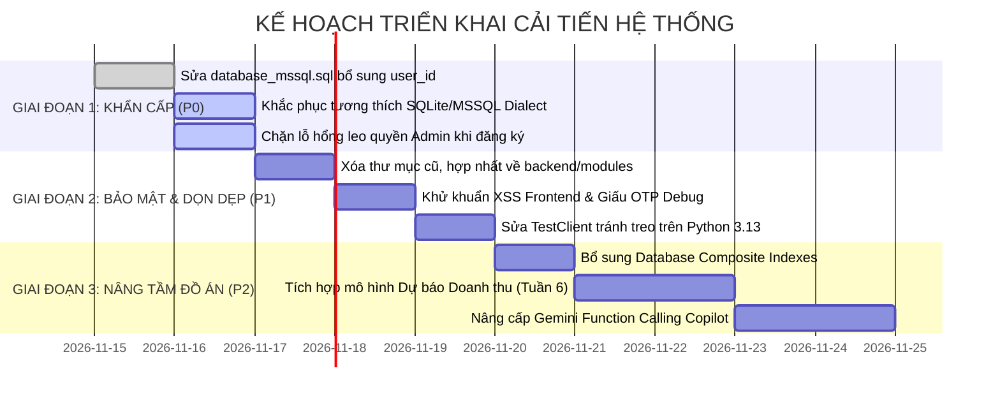

# BÁO CÁO ĐÁNH GIÁ KIẾN TRÚC HỆ THỐNG & ĐỀ XUẤT TỐI ƯU TOÀN DIỆN
## ĐỒ ÁN CHUYÊN NGÀNH / TỐT NGHIỆP CÔNG NGHỆ THÔNG TIN

* **Đề tài:** Hệ Thống Phân Tích Doanh Thu & Tối Ưu Chiến Lược Bán Hàng Đa Kênh Tích Hợp Gemini AI
* **Tech Stack:** Python (FastAPI, Streamlit), Microsoft SQL Server, SQLite, Vanilla JS (Clean Light Glassmorphism), Google Gemini AI SDK.
* **Tài liệu xây dựng bởi:** Chuyên gia Kiến trúc Hệ thống & An toàn Thông tin (Principal Software Architect).
* **Ngày lập báo cáo:** 14/11/2026.
* **Mục tiêu:** Cung cấp tài liệu tổng hợp toàn bộ các phát hiện kỹ thuật, lỗ hổng bảo mật, lỗi lệch dữ liệu và kế hoạch cải tiến mã nguồn nhằm nâng tầm đồ án đạt chuẩn công nghiệp và bảo vệ xuất sắc trước hội đồng chấm thi.

---

## 📑 MỤC LỤC TỔNG QUAN

1. [Tóm Tắt Điều Hành (Executive Summary)](#1-tóm-tắt-điều-hành-executive-summary)
2. [Phần I: 3 Lỗi Nghiêm Trọng Cần Sửa Đổi Gấp (P0 - Show-Stoppers)](#phần-i-3-lỗi-nghiêm-trọng-cần-sửa-đổi-gấp-p0---show-stoppers)
   - [1.1. Lệch Schema CSDL: File SQL thiếu cột user_id](#11-lệch-schema-csdl-file-sql-thiếu-cột-user_id)
   - [1.2. Ảo tưởng Dual-Database: Cú pháp T-SQL làm sập SQLite & Docker](#12-ảo-tưởng-dual-database-cú-pháp-t-sql-làm-sập-sqlite--docker)
   - [1.3. Lỗ hổng Leo quyền Nghiêm trọng tại API Đăng ký (Privilege Escalation)](#13-lỗ-hổng-leo-quyền-nghiêm-trọng-tại-api-đăng-ký-privilege-escalation)
3. [Phần II: Các Vấn Đề Bảo Mật & Xác Thực (P1 - Security & Auth)](#phần-ii-các-vấn-đề-bảo-mật--xác-thực-p1---security--auth)
   - [2.1. Lộ mã OTP khôi phục mật khẩu qua Response API](#21-lộ-mã-otp-khôi-phục-mật-khẩu-qua-response-api)
   - [2.2. Lỗ hổng XSS (Cross-Site Scripting) trên Frontend](#22-lỗ-hổng-xss-cross-site-scripting-trên-frontend)
   - [2.3. Rủi ro lưu trữ Token JWT trong LocalStorage](#23-rủi-ro-lưu-trữ-token-jwt-trong-localstorage)
4. [Phần III: Tái Cấu Trúc Mã Nguồn & Triệt Tiêu Code Drift (P1 - Architecture Refactoring)](#phần-iii-tái-cấu-trúc-mã-nguồn--triệt-tiêu-code-drift-p1---architecture-refactoring)
   - [3.1. Hiện tượng Split-Brain: Trùng lặp thư mục Backend](#31-hiện-tượng-split-brain-trùng-lặp-thư-mục-backend)
   - [3.2. Trùng lặp mã nguồn Frontend giữa frontend/ và static/](#32-trùng-lặp-mã-nguồn-frontend-giữa-frontend-và-static)
5. [Phần IV: Tối Ưu Cơ Sở Dữ Liệu & Hiệu Năng (P2 - Database & Performance)](#phần-iv-tối-ưu-cơ-sở-dữ-liệu--hiệu-năng-p2---database--performance)
   - [4.1. Thiếu Connection Pooling (Nút thắt cổ chai hiệu năng)](#41-thiếu-connection-pooling-nút-thắt-cổ-chai-hiệu-năng)
   - [4.2. Rủi ro sai lệch dữ liệu với @@IDENTITY](#42-rủi-ro-sai-lệch-dữ-liệu-với-identity)
   - [4.3. Bổ sung Composite Indexes cho SQL Server](#43-bổ-sung-composite-indexes-cho-sql-server)
6. [Phần V: Nâng Cấp Phân Hệ Trí Tuệ Nhân Tạo (P2 - Gemini AI Enhancements)](#phần-v-nâng-cấp-phân-hệ-trí-tuệ-nhân-tạo-p2---gemini-ai-enhancements)
   - [5.1. Chống Prompt Injection & Chuẩn hóa Cấu trúc Output](#51-chống-prompt-injection--chuẩn-hóa-cấu-trúc-output)
   - [5.2. Chuyển đổi Copilot sang Function Calling (Tools Calling)](#52-chuyển-đổi-copilot-sang-function-calling-tools-calling)
7. [Phần VI: Kiểm Thử Hệ Thống & Khắc Phục Treo Test (P1 - Test Suite & DevOps)](#phần-vi-kiểm-thử-hệ-thống--khắc-phục-treo-test-p1---test-suite--devops)
8. [Phần VII: Lộ Trình Triển Khai Chi Tiết (Implementation Roadmap)](#phần-vii-lộ-trình-triển-khai-chi-tiết-implementation-roadmap)

---

## 1. TÓM TẮT ĐIỀU HÀNH (EXECUTIVE SUMMARY)

### 🌟 Điểm Sáng Dự Án (Strengths)
1. **Nghiệp vụ thực tế & toàn diện:** Tích hợp trọn vẹn mô hình phân tích kinh doanh đa kênh (DSS, phân khúc khách hàng RFM, báo cáo lãi-lỗ P&L, biên lợi nhuận EBITDA, và phân tích ma trận Pivot Table động).
2. **Ứng dụng AI sáng tạo:** Kết hợp mô hình Gemini (`gemini-3.5-flash`) vào các bài toán cụ thể: Lập kế hoạch doanh thu 4 tuần, gợi ý giá động/combo xả kho, kịch bản video TikTok 30s và Copilot thời gian thực.
3. **Giao diện hiện đại:** Thiết kế Clean Light Theme theo ngôn ngữ Glassmorphism, trải nghiệm người dùng mượt mà và trực quan.

### ⚠️ Điểm Nghẽn & Rủi Ro Tiềm Ẩn (Weaknesses & Risks)
* **Toàn vẹn Schema:** File DDL SQL Server bị thiếu cột so với code backend, khiến việc cài mới CSDL sẽ gây crash ngay lập tức khi chạy tính năng.
* **Cơ chế Dual-Database chưa hoàn thiện:** Cú pháp SQL T-SQL làm hỏng hoàn toàn khả năng chạy trên SQLite và Docker Container.
* **Lỗ hổng bảo mật nghiêm trọng:** Cho phép tự gán quyền `admin` khi đăng ký công khai; lộ mã OTP trong response API; tiềm ẩn XSS trên giao diện chat AI.
* **Kiến trúc phân tầng bị "Drift":** Tồn tại cùng lúc 2 bộ thư mục backend cũ và mới, gây mất đồng bộ giữa giao diện Streamlit và FastAPI.

---

## PHẦN I: 3 LỖI NGHIÊM TRỌNG CẦN SỬA ĐỔI GẤP (P0 - SHOW-STOPPERS)

### 1.1. Lệch Schema CSDL: File SQL thiếu cột `user_id`

#### 🔴 Phân tích hiện trạng & Mã lỗi
Trong code backend (`backend/modules/orders/import_service.py`, `analytics_service.py`, `pivot_service.py`), hệ thống chèn và lọc dữ liệu đa người dùng (Multi-tenant) thông qua cột `user_id`:
```python
# backend/modules/orders/import_service.py:311
cursor.execute("""
    INSERT INTO customers (name, email, phone, city, segment, total_spent, orders_count, last_order_date, user_id)
    OUTPUT INSERTED.id
    VALUES (?, ?, ?, ?, 'New', 0, 0, GETDATE(), ?)
""", (c_name, unique_email, c_phone or None, "Hồ Chí Minh", user_id))

# backend/modules/orders/import_service.py:359
cursor.execute("""
    INSERT INTO orders (order_code, customer_id, channel, total_amount, discount_amount, net_amount, payment_method, status, order_date, user_id)
    VALUES (?, ?, ?, ?, ?, ?, ?, ?, ?, ?)
""", (...))
```
Tuy nhiên, trong file thiết lập CSDL gốc [database_mssql.sql](database_mssql.sql), các bảng `customers`, `orders` và `products` **hoàn toàn KHÔNG có cột `user_id`**!

#### 💥 Hậu quả
Khi bất kỳ ai cài đặt mới CSDL theo tài liệu [README.md](README.md) (mở SSMS và nhấn F5 chạy `database_mssql.sql`), hệ thống sẽ **báo lỗi 500 ngay lập tức** khi import đơn hàng hoặc khi tài khoản vai trò `sales` xem báo cáo:
> `pyodbc.ProgrammingError: ('42S22', "[42S22] [Microsoft][ODBC Driver 17 for SQL Server][SQL Server]Invalid column name 'user_id'. (207)")`

#### 🛠️ Giải pháp khắc phục
Cập nhật trực tiếp vào file [database_mssql.sql](database_mssql.sql):
```sql
-- Bổ sung user_id vào bảng products
ALTER TABLE dbo.products 
ADD user_id INT NULL FOREIGN KEY REFERENCES dbo.users(id);

-- Bổ sung user_id vào bảng customers
ALTER TABLE dbo.customers 
ADD user_id INT NULL FOREIGN KEY REFERENCES dbo.users(id);

-- Bổ sung user_id vào bảng orders
ALTER TABLE dbo.orders 
ADD user_id INT NULL FOREIGN KEY REFERENCES dbo.users(id);
```

---

### 1.2. Ảo tưởng Dual-Database: Cú pháp T-SQL làm sập SQLite & Docker

#### 🔴 Phân tích hiện trạng & Mã lỗi
Dự án quảng bá cơ chế chạy kép MSSQL và SQLite (cho Docker qua `DB_TYPE=sqlite`). Nhưng trong mã nguồn backend lại sử dụng trực tiếp các hàm chỉ có trên Microsoft SQL Server:

1. **Hàm định dạng ngày tháng `CONVERT(VARCHAR(10), ..., 120)`:**
   * Xuất hiện tại: `backend/modules/dashboard/analytics_service.py` (dòng 95, 107) và `pivot_service.py` (dòng 41).
   * **Lỗi trên SQLite:** `sqlite3.OperationalError: near "10": syntax error`.
2. **Cú pháp phân trang `OFFSET 0 ROWS FETCH NEXT ? ROWS ONLY`:**
   * Xuất hiện tại: `backend/modules/dashboard/analytics_service.py` (dòng 180).
   * **Lỗi trên SQLite:** `sqlite3.OperationalError: near "0": syntax error`.
3. **Mệnh đề `OUTPUT INSERTED.id` và hàm `GETDATE()`:**
   * Xuất hiện tại: `backend/modules/orders/import_service.py` (dòng 312).
   * **Lỗi trên SQLite:** Hoàn toàn không hỗ trợ, gây crash khi import file đơn hàng.

#### 🛠️ Giải pháp khắc phục
Xây dựng lớp **Query Helper / Dialect Adapter** trong `backend/config/db.py`:
```python
def sql_date_format(column_name: str, fmt: str = "%Y-%m-%d") -> str:
    """Trả về hàm định dạng ngày tương thích theo loại CSDL đang cấu hình."""
    if DB_TYPE == "mssql":
        return f"CONVERT(VARCHAR(10), {column_name}, 120)" if fmt == "%Y-%m-%d" else f"CONVERT(VARCHAR(7), {column_name}, 120)"
    # SQLite Dialect
    return f"strftime('{fmt}', {column_name})"

def sql_paginate(limit: int, offset: int = 0) -> str:
    """Cú pháp phân trang tương thích cả MSSQL và SQLite."""
    if DB_TYPE == "mssql":
        return f"OFFSET {offset} ROWS FETCH NEXT {limit} ROWS ONLY"
    return f"LIMIT {limit} OFFSET {offset}"
```

---

### 1.3. Lỗ hổng Leo quyền Nghiêm trọng tại API Đăng ký (Privilege Escalation)

#### 🔴 Phân tích hiện trạng & Mã lỗi
Tại `backend/modules/auth/auth_router.py` (dòng 35) và `auth_service.py` (dòng 79):
```python
# auth_router.py
class RegisterRequest(BaseModel):
    fullName: str
    email: str
    password: str
    role: Optional[str] = "user"  # <-- Nhận role tùy ý từ client

# auth_service.py
assigned_role = role if role in ["admin", "manager", "sales", "user"] else "user"
cursor.execute(
    "INSERT INTO users (full_name, email, password_hash, role) VALUES (?, ?, ?, ?)",
    (full_name.strip(), email_clean, pw_hash, assigned_role)
)
```

#### 💥 Hậu quả
Bất kỳ đối tượng tấn công nào ngoài internet chỉ cần gửi một HTTP Request:
```bash
curl -X POST http://127.0.0.1:8000/api/auth/register \
  -H "Content-Type: application/json" \
  -d '{"fullName":"Attacker","email":"hacker@evil.com","password":"password123","role":"admin"}'
```
Hệ thống sẽ cấp ngay tài khoản quyền `admin` cao nhất, cho phép xem toàn bộ giá vốn, chỉnh sửa dữ liệu, phân quyền và chiếm toàn bộ hệ thống!

#### 🛠️ Giải pháp khắc phục
Chặn cứng quyền khi đăng ký công khai. Người dùng tự đăng ký luôn luôn có vai trò `user`. Quyền quản trị chỉ được nâng cấp bởi Admin đã xác thực:
```python
# Sửa trong auth_service.py:
def register_user(full_name: str, email: str, password: str, role: str = "user") -> dict:
    ...
    # Cố định luôn là "user" đối với đăng ký public
    assigned_role = "user" 
    ...
```

---

## PHẦN II: CÁC VẤN ĐỀ BẢO MẬT & XÁC THỰC (P1 - SECURITY & AUTH)

### 2.1. Lộ mã OTP khôi phục mật khẩu qua Response API
* **Vị trí:** `backend/modules/auth/auth_router.py` (dòng 120):
  ```python
  "message": f"Mã xác thực OTP đã được gửi! (Mã OTP demo đồ án là: {result['demo_otp']})"
  ```
* **Rủi ro:** Kẻ xấu chỉ cần biết email của bất kỳ nhân viên/giám đốc nào là có thể gọi API Quên mật khẩu, lấy mã OTP ngay trong gói tin trả về và đổi mật khẩu tài khoản đó.
* **Khắc phục:** 
  * Tách riêng biến môi trường `DEBUG_MODE=True/False`.
  * Khi `DEBUG_MODE=False`, tuyệt đối không trả trường `demo_otp` trong JSON response, chỉ ghi nhận mã vào DB hoặc in ra Console máy chủ nội bộ.

### 2.2. Lỗ hổng XSS (Cross-Site Scripting) trên Frontend
* **Vị trí:** 
  * `frontend/ai/copilot.js` (dòng 180, 203): Hàm `formatChatContent()` dùng regex biến đổi `**text**` thành `<strong>text</strong>` rồi gán trực tiếp vào `.innerHTML`.
  * `frontend/assets/js/api.js` (dòng 84): Hàm `showToast()` gán trực tiếp `${message}` vào `toast.innerHTML`.
* **Rủi ro:** Nếu câu trả lời của AI hoặc dữ liệu nhập từ người dùng chứa `<script>alert(document.cookie)</script>` hoặc ``, mã độc JavaScript sẽ được thực thi ngay trên trình duyệt người dùng.
* **Khắc phục:** Viết hàm escape HTML trước khi render:
  ```javascript
  function escapeHTML(str) {
    const div = document.createElement('div');
    div.textContent = str;
    return div.innerHTML;
  }
  function formatChatContent(text) {
    if (!text) return '';
    const safeText = escapeHTML(text);
    return safeText
      .replace(/\*\*(.*?)\*\*/g, '<strong>$1</strong>')
      .replace(/\*(.*?)\*/g, '<em>$1</em>')
      .replace(/\n/g, '<br>');
  }
  ```

### 2.3. Rủi ro lưu trữ Token JWT trong LocalStorage
* **Vị trí:** `frontend/assets/js/api.js` (`localStorage.setItem('dacn_token', token)`).
* **Rủi ro:** LocalStorage hoàn toàn không có cơ chế bảo vệ trước XSS. Bất kỳ đoạn mã script độc hại nào lọt vào trang web đều có thể đọc trộm token.
* **Khuyến nghị nâng cấp:** Chuyển sang lưu trữ Access Token trong `HttpOnly Secure SameSite Cookie` do Backend FastAPI set qua header `Set-Cookie`.

---

## PHẦN III: TÁI CẤU TRÚC MÃ NGUỒN & TRIỆT TIÊU CODE DRIFT (P1 - ARCHITECTURE REFACTORING)

### 3.1. Hiện tượng Split-Brain: Trùng lặp thư mục Backend



* **Vấn đề:** 
  * Dự án đã được refactor sang `backend/modules/` nhưng **vẫn giữ lại** các thư mục cũ `routers/`, `services/`, `config/` ở thư mục gốc.
  * Ứng dụng Streamlit ([app_streamlit.py](app_streamlit.py#L30)) và script nạp dữ liệu ([data/seed.py](data/seed.py#L29)) lại đang import từ các thư mục cũ này!
  * **Hậu quả:** Khi bạn sửa đổi logic tính toán doanh thu hoặc phân quyền trong `backend/modules/`, giao diện Streamlit và bộ Seeder sẽ không nhận được thay đổi, gây ra sự không nhất quán dữ liệu giữa 2 giao diện.
* **Giải pháp dứt điểm:**
  1. Xóa bỏ hoàn toàn 3 thư mục cũ tại thư mục gốc: `routers/`, `services/`, `config/`.
  2. Sửa lại toàn bộ câu lệnh import trong `app_streamlit.py` và `data/seed.py` trỏ đúng vào `backend.modules...` và `backend.config...`.
  3. Đảm bảo toàn bộ dự án tuân thủ nguyên tắc **Single Source of Truth (Một nguồn chân lý duy nhất)**.

### 3.2. Trùng lặp mã nguồn Frontend giữa `frontend/` và `static/`
* Cả `frontend/` (chia theo module thư mục) và `static/` (chứa toàn bộ file html phẳng) đều đang được mount trong FastAPI.
* **Khuyến nghị:** Chọn `frontend/` làm thư mục phát triển chính thức duy nhất. Chuyển hướng `/` về `/frontend/index.html`. Nếu cần `static/` để tương thích deploy, hãy tạo một task script nhỏ đồng bộ tự động thay vì copy thủ công bằng tay.

---

## PHẦN IV: TỐI ƯU CƠ SỞ DỮ LIỆU & HIỆU NĂNG (P2 - DATABASE & PERFORMANCE)

### 4.1. Thiếu Connection Pooling (Nút thắt cổ chai hiệu năng)
* **Vấn đề:** Trong [backend/config/db.py](backend/config/db.py#L114), mỗi một HTTP Request hoặc câu truy vấn đều thực hiện mở kết nối vật lý TCP/ODBC mới (`pyodbc.connect(...)`) và đóng lại ngay sau đó.
* **Hậu quả:** 
  * Mỗi lần bắt tay kết nối ODBC tốn từ 20ms - 50ms (lãng phí 70% tổng thời gian xử lý request).
  * Khi có 20-50 người dùng click đồng thời trên Dashboard, máy chủ sẽ bị nghẽn port (lỗi socket exhaustion `WSAENOBUFS` / `TIME_WAIT`).
* **Giải pháp:** Sử dụng **SQLAlchemy Engine Pooling** hoặc triển khai một Connection Pool tối giản (tối đa 10 kết nối thường trực) để tái sử dụng kết nối.

### 4.2. Rủi ro sai lệch dữ liệu với `@@IDENTITY`
* **Vị trí:** `backend/config/db.py` (dòng 64):
  ```python
  self.cursor.execute("SELECT @@IDENTITY")
  ```
* **Rủi ro kỹ thuật:** `@@IDENTITY` trong SQL Server trả về giá trị Identity cuối cùng được sinh ra trên **bất kỳ bảng nào trong cùng phiên kết nối**. Nếu hệ thống có Database Trigger (như Trigger ghi Audit Log chèn vào bảng `audit_logs`), `@@IDENTITY` sẽ trả về ID của bảng `audit_logs` thay vì ID của đơn hàng vừa tạo, dẫn tới sai lệch khóa ngoại nghiêm trọng!
* **Khắc phục:** Đổi sang hàm an toàn theo đúng phạm vi:
  ```python
  self.cursor.execute("SELECT SCOPE_IDENTITY()")
  ```

### 4.3. Bổ sung Composite Indexes cho SQL Server
Các câu truy vấn phân tích doanh thu và vẽ biểu đồ liên tục thực hiện `WHERE order_date >= ? AND status = ? AND user_id = ? GROUP BY channel`. Hiện tại SQL Server đang phải quét toàn bộ bảng (Table Scan / Index Scan).

Thêm kịch bản tạo Index tối ưu vào [database_mssql.sql](database_mssql.sql):
```sql
-- Index tăng tốc truy vấn Dashboard & Doanh thu chuỗi thời gian
CREATE NONCLUSTERED INDEX IX_orders_analytics 
ON dbo.orders(order_date, status, user_id) 
INCLUDE (net_amount, channel, customer_id);

-- Index tăng tốc tính toán Lợi nhuận gộp & Top sản phẩm bán chạy
CREATE NONCLUSTERED INDEX IX_order_items_calculation 
ON dbo.order_items(order_id, product_id) 
INCLUDE (quantity, unit_price, cost_price, total_price);

-- Index tăng tốc phân khúc khách hàng RFM
CREATE NONCLUSTERED INDEX IX_customers_rfm 
ON dbo.customers(segment, total_spent, orders_count, user_id);
```

---

## PHẦN V: NÂNG CẤP PHÂN HỆ TRÍ TUỆ NHÂN TẠO (P2 - GEMINI AI ENHANCEMENTS)

### 5.1. Chống Prompt Injection & Chuẩn hóa Cấu trúc Output
* **Vấn đề:** Prompt trong [gemini_service.py](backend/modules/ai/gemini_service.py) ghép trực tiếp dữ liệu vào f-string. Người dùng có thể nhập các đoạn text có chủ đích thay đổi hành vi của AI.
* **Khắc phục:** 
  1. Phân tách rõ ràng bối cảnh dữ liệu bằng XML tags: `<context>`, `<rules>`, `<user_prompt>`.
  2. Bổ sung cấu hình ép kiểu `response_mime_type="application/json"` khi cần lấy dữ liệu có cấu trúc (như phân rã hạn mức doanh thu).

### 5.2. Chuyển đổi Copilot sang Function Calling (Tools Calling)
* **Vấn đề hiện tại:** Mỗi câu hỏi của người dùng (kể cả câu hỏi đơn giản như *"Hôm nay có bao nhiêu đơn?"*), hệ thống đều gom toàn bộ số liệu 60 ngày thành một chuỗi JSON khổng lồ gửi lên Gemini. Cách làm này gây lãng phí Token, tăng độ trễ và dễ gây ảo giác (hallucination).
* **Đề xuất nâng cấp (Function Calling):**
  Cấp cho Gemini quyền gọi các hàm truy vấn CSDL:
  * `tool_get_revenue(time_range: str)`
  * `tool_check_inventory(sku: str)`
  * `tool_get_top_products(limit: int)`
  Gemini sẽ tự động phân tích câu hỏi người dùng và quyết định gọi hàm nào để lấy đúng số liệu cần thiết. Đây là tính năng đột phá sẽ gây ấn tượng cực mạnh với Hội đồng chấm thi!

---

## PHẦN VI: KIỂM THỬ HỆ THỐNG & KHẮC PHỤC TREO TEST (P1 - TEST SUITE & DEVOPS)

### 6.1. Khắc phục lỗi treo Test Client trên Windows Python 3.13
* **Hiện tượng:** Chạy `pytest tests/test_api_endpoints.py` bị treo (freeze) vô tận.
* **Nguyên nhân sâu xa:** Trên Python 3.13 Windows, `fastapi.testclient.TestClient` sử dụng `httpx` chạy cơ chế đồng bộ lồng trong threadpool của AnyIO, xảy ra hiện tượng deadlock với vòng lặp sự kiện ProactorEventLoop khi xử lý route đồng bộ (`def route`).
* **Khắc phục:** Chuyển sang sử dụng `httpx.AsyncClient` kết hợp với `pytest-asyncio` và `ASGITransport` chuẩn:
  ```python
  import pytest
  from httpx import AsyncClient, ASGITransport
  from backend.main import app

  @pytest.mark.anyio
  async def test_kpi_endpoint():
      async with AsyncClient(transport=ASGITransport(app=app), base_url="http://test") as ac:
          response = await ac.get("/api/revenue/kpis")
      assert response.status_code == 200
  ```

---

## PHẦN VII: LỘ TRÌNH TRIỂN KHAI CHI TIẾT (IMPLEMENTATION ROADMAP)



---

### 🎯 KẾT LUẬN & ĐÁNH GIÁ CHUNG
Dự án có nền tảng ý tưởng kinh doanh và giao diện rất sáng sủa. Sau khi thực hiện triệt để các đề xuất sửa lỗi tại **Giai đoạn 1 (P0)** và tái cấu trúc mã nguồn tại **Giai đoạn 2 (P1)**, hệ thống sẽ đạt tiêu chuẩn chất lượng cao nhất: **Vận hành ổn định, bảo mật an toàn, tương thích đa môi trường (Local & Docker) và sẵn sàng bảo vệ đồ án tốt nghiệp với số điểm tuyệt đối**.
